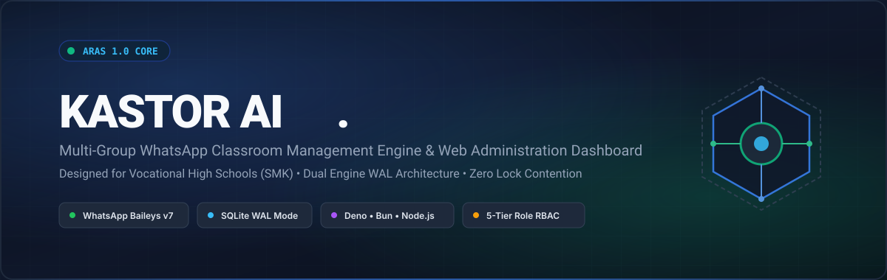
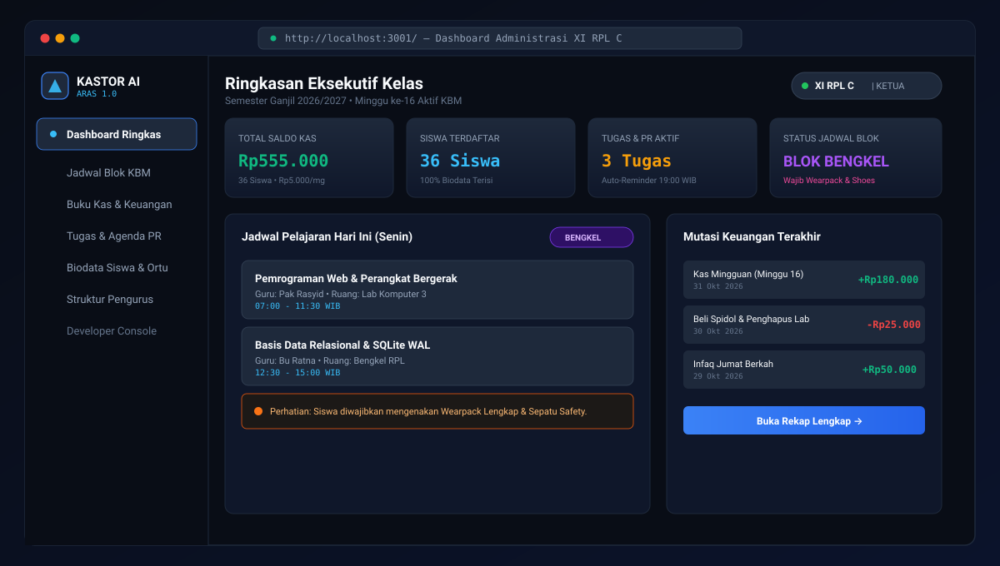
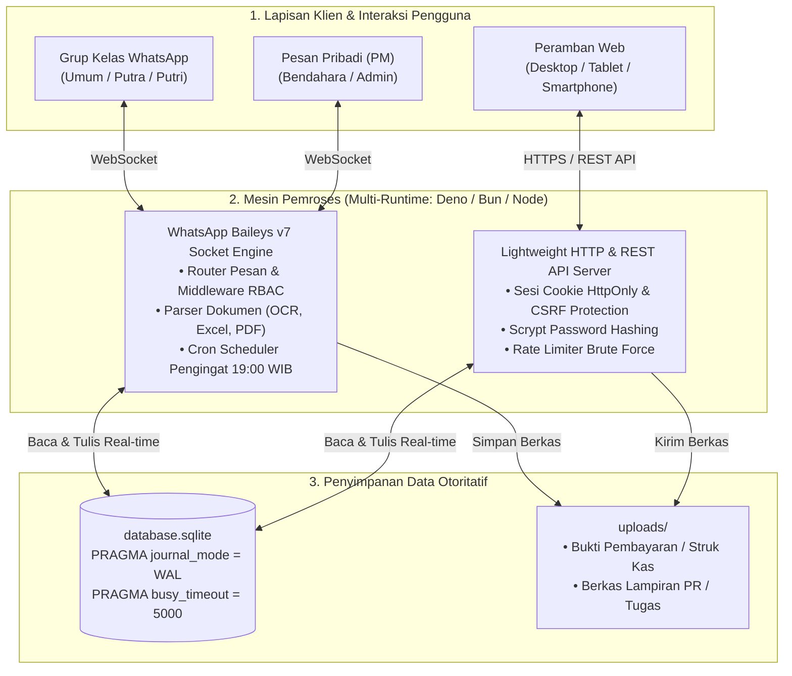

<p align="center">
  
</p>

<p align="center">
  <a href="https://github.com/Rasyid2567/Kastor-AI/actions"></a>
  <a href="LICENSE"></a>
  <a href="https://deno.com"></a>
  <a href="https://bun.sh"></a>
  <a href="https://nodejs.org"></a>
  <a href="https://github.com/Rasyid2567/Kastor-AI/releases"></a>
  <a href="CONTRIBUTING.md"></a>
</p>

---

## 📌 Daftar Isi
- [Tentang Kastor AI](#-tentang-kastor-ai)
- [Tampilan Antarmuka Web Dashboard](#-tampilan-antarmuka-web-dashboard)
- [Arsitektur Sistem (Dual Engine SQLite WAL)](#-arsitektur-sistem)
- [Simulasi Obrolan WhatsApp Bot](#-simulasi-obrolan-whatsapp-bot)
- [Daftar Perintah Bot Lengkap (Command Reference)](#-daftar-perintah-bot-lengkap)
- [Matriks Otorisasi Hak Akses (RBAC)](#-matriks-otorisasi-hak-akses-rbac)
- [Panduan Memulai Cepat (Quickstart)](#-panduan-memulai-cepat-quickstart)
- [Konfigurasi Variabel Lingkungan (.env)](#-konfigurasi-variabel-lingkungan-env)
- [Deployment Produksi (Linux Systemd VPS)](#-deployment-produksi-linux-systemd-vps)
- [Pengujian Otomatis (Automated Testing)](#-pengujian-otomatis)
- [Kontribusi & Lisensi](#-kontribusi--lisensi)

---

## 📖 Tentang Kastor AI

**Kastor AI (ARAS 1.0)** adalah platform manajemen kelas modern terintegrasi yang dirancang untuk memecahkan kompleksitas administrasi akademik di Sekolah Menengah Kejuruan (SMK) dan sekolah umum. 

Sistem ini menggabungkan **Bot WhatsApp Multi-Grup** berbasis socket Baileys dengan **Web Administration Dashboard** modern (Midnight Slate Dark Theme). Keduanya berbagi basis data lokal berkinerja tinggi melalui mode **SQLite WAL (Write-Ahead Logging)**, memungkinkan pembacaan dan penulisan bersamaan secara instan tanpa konflik (*zero lock contention*).

### 🎯 Nilai Inti & Solusi Nyata:
1. **Kurikulum Sistem Blok SMK**: Otomatis mendeteksi jadwal ganjil/genap antara **Blok Teori** di kelas dan **Blok Bengkel / Praktikum** di lab komputer, lengkap dengan peringatan kelengkapan wearpack & safety shoes.
2. **Pembukuan Kas Kelas Transparan**: Input privat melalui pesan pribadi bendahara (via teks centang atau impor Excel `.xlsx`), dilaporkan secara elegan di grup WhatsApp tanpa angka total tunggakan yang mengintimidasi siswa.
3. **Automasi Pengingat Tugas (Cron Scheduler)**: Bot otomatis menyiarkan rekapitulasi pekerjaan rumah (PR) aktif ke grup setiap pukul 19.00 WIB untuk tugas yang tenggatnya mendekati $\le 24$ jam.
4. **Multi-Group Class Linking**: Menghubungkan grup WhatsApp cabang (grup putra, putri, atau kelompok belajar) ke satu induk kelas yang sama.
5. **Privasi Data Siswa & Orang Tua**: Modul rahasia `/ortu` yang terisolasi dari menu publik untuk menjaga kerahasiaan kontak wali murid.

---

## 🖥️ Tampilan Antarmuka Web Dashboard

Dashboard administrasi kelas dibangun menggunakan antarmuka murni **Vanilla ES6 Modules** tanpa overhead bundler eksternal, mengusung palet warna **Midnight Slate Dark Theme** yang elegan dan responsif di peramban desktop maupun ponsel pintar:

<p align="center">
  
</p>

---

## 🏛️ Arsitektur Sistem

Kastor AI menggunakan pendekatan **Dual-Engine Shared State**:



---

## 💬 Simulasi Obrolan WhatsApp Bot

Berikut adalah pratinjau format pesan teks otentik yang dihasilkan oleh bot WhatsApp:

### 1. Jadwal Pelajaran Sistem Blok (`/jadwal`)
```text
📅 JADWAL HARI SENIN (Minggu ke-16)
🏫 Kelas: XI RPL C
────────────────────────────

📖 Mapel: Pemrograman Web & Perangkat Bergerak
👨‍🏫 Guru : Bpk. Rasyid
🚪 Ruang: Lab RPL 3
⏰ Jam  : 07.00 - 11.30 WIB

📖 Mapel: Basis Data & SQLite WAL
👨‍🏫 Guru : Ibu Ratna
🚪 Ruang: Bengkel RPL
⏰ Jam  : 12.30 - 15.00 WIB

────────────────────────────
⚠️ BLOK BENGKEL / LAB:
Siswa wajib mengenakan Wearpack Lengkap & Safety Shoes!
```

### 2. Transparansi Kas Terbuka di Grup (`/kas`)
```text
📊 REKAP KAS KELAS XI RPL C
────────────────────────────
1. Naswa: ✅
2. Natasya: ✅
3. Nia Felly: ✅
4. Nicko: ✅
5. Nikita: Rp10.000
6. Noviesca: Rp10.000
7. Aditya: ✅
...
36. Zakaria: Rp5.000
────────────────────────────
💡 Tarif Kas: Rp5.000 / minggu
💡 Pembayaran dapat diserahkan langsung ke Bendahara.
```

### 3. Pengingat Tugas & PR Otomatis (`/pr`)
```text
📝 DAFTAR TUGAS & PR AKTIF
────────────────────────────
📌 [ID: 28] Pemrograman Web
⏰ Tenggat: Besok, 07:30 WIB (Sisa 12 Jam)
📖 Keterangan: Selesaikan layout responsive dashboard CSS Grid.

📌 [ID: 29] Basis Data Relasional
⏰ Tenggat: 2 November 2026, 23:59 WIB
📖 Keterangan: Buat ERD dan normalisasi tabel 1NF hingga 3NF.
────────────────────────────
💡 Selesaikan tugas sebelum batas waktu berakhir!
```

### 4. Perintah Rahasia Data Orang Tua (`/ortu 1`)
```text
👨‍👩‍👧‍👦 DATA ORANG TUA SISWA
────────────────────────────
Absen  : 1
Nama   : Nasywa Taqi Sasikirana
Ortu   : Bambang Sasikirana
────────────────────────────
Kontak Siswa: @6282140474039
────────────────────────────
```

---

## 📋 Daftar Perintah Bot Lengkap

### 📅 Modul Jadwal Pelajaran (Sistem Blok)
| Perintah | Hak Akses | Contoh Penggunaan | Deskripsi |
|---|---|---|---|
| `/jadwal` | Semua Member | `/jadwal` | Jadwal KBM hari ini sesuai minggu blok berjalan |
| `/jadwal besok` | Semua Member | `/jadwal besok` | Jadwal KBM untuk hari esok |
| `/jadwal [hari]` | Semua Member | `/jadwal selasa` | Jadwal KBM pada hari tertentu di minggu ini |
| `/jadwal depan` | Semua Member | `/jadwal depan` | Jadwal KBM pada minggu selanjutnya |
| `/jadwal lalu` | Semua Member | `/jadwal lalu` | Jadwal KBM pada minggu sebelumnya |
| `/jadwal now` | Semua Member | `/jadwal now` | Mapel yang sedang berlangsung pada jam ini |
| `/jadwal full` | Semua Member | `/jadwal full` | Rekap jadwal Senin s/d Jumat minggu aktif |
| `/jadwal cari [nama]` | Semua Member | `/jadwal cari Bu Ratna` | Mencari jadwal berdasarkan nama guru pengampu |

### 💰 Modul Kas & Keuangan Kelas
| Perintah | Hak Akses | Contoh Penggunaan | Deskripsi |
|---|---|---|---|
| `/kas` | Semua Member | `/kas` | Rekap status pembayaran kas seluruh siswa kelas |
| `/kas set [nominal]` | Bendahara (PM) | `/kas set 5000` | Mengatur nominal iuran kas mingguan kelas |
| `/kas [teks_ceklis]` | Bendahara (PM) | `1. Budi✅\n2. Siti✅` | Rekapitulasi kas kilat via daftar centang |
| `/kas upload` | Bendahara (PM) | Kirim file `.xlsx` | Impor data kas massal via berkas Excel |
| `/keuangan` | Pengurus / Dev | `/keuangan` | Laporan buku kas (saldo, pemasukan non-kas, pengeluaran) |

### 📝 Modul Tugas & PR
| Perintah | Hak Akses | Contoh Penggunaan | Deskripsi |
|---|---|---|---|
| `/pr` | Semua Member | `/pr` | Menampilkan seluruh daftar tugas/PR yang masih aktif |
| `/pr all` | Semua Member | `/pr all` | Menampilkan seluruh tugas (termasuk yang telah selesai) |
| `/pr add` | Pengurus / Dev | `/pr add Basis Data \| 2026-11-02 23:59 \| Buat ERD` | Menambahkan agenda tugas baru ke database |
| `/pr done [id]` | Pengurus / Dev | `/pr done 28` | Menandai tugas telah selesai dikerjakan |
| `/pr del [id]` | Pengurus / Dev | `/pr del 28` | Menghapus data tugas dari database |

### 👥 Modul Siswa & Data Orang Tua
| Perintah | Hak Akses | Contoh Penggunaan | Deskripsi |
|---|---|---|---|
| `/siswa` | Semua Member | `/siswa` | Daftar nomor absen dan nama siswa di kelas |
| `/siswa detail [no/nama]` | Semua Member | `/siswa detail 1` | Menampilkan biodata lengkap siswa |
| `/siswa add` | Admin Kelas | `/siswa add 1 Budi @6281234567890` | Mendaftarkan siswa baru ke kelas |
| `/siswa import` | Admin Kelas | `/siswa import [teks_baris]` | Mendaftarkan siswa massal (bulk import) |
| `/ortu [no/nama]` | Rahasia (Admin/Member) | `/ortu 1` atau `/ortu` | Menampilkan data orang tua siswa *(Perintah Rahasia)* |

### 🔗 Modul Multi-Group Class Linking
| Perintah | Hak Akses | Contoh Penggunaan | Deskripsi |
|---|---|---|---|
| `/link [kelas] [penanda]` | Admin Grup / Dev | `/link XI RPL C Khusus Cowok` | Menautkan grup cabang ke kelas induk |
| `/link list` | Admin Grup / Dev | `/link list` | Melihat daftar grup cabang yang terhubung |
| `/unlink` | Admin Grup / Dev | `/unlink` | Memutuskan tautan grup cabang |

### 🛠️ Media, Alat Bantu & AI Assistant
| Perintah | Hak Akses | Contoh Penggunaan | Deskripsi |
|---|---|---|---|
| `/s` atau `/sticker` | Semua Member | Kirim foto/video dengan caption `/s` | Konversi gambar/video ke stiker WebP |
| `/toimg` | Semua Member | Balas stiker dengan `/toimg` | Konversi stiker WebP ke gambar JPEG |
| `/ocr` | Semua Member | Kirim foto dengan caption `/ocr` | Ekstraksi teks dari foto dokumen/papan tulis |
| `/topdf` | Semua Member | Kirim dokumen dengan `/topdf` | Menggabungkan gambar menjadi berkas PDF |
| `/calc [rumus]` | Semua Member | `/calc (250 * 4) + 1500 / 3` | Kalkulator perhitungan matematika instan |
| `/ai` atau `/tanya` | Semua Member | `/ai apa perbedaan INNER JOIN dan LEFT JOIN?` | Asisten AI bertenaga Google Gemini / Ollama |
| `/rvo` | Rahasia | Balas media View Once dengan `/rvo` | Membuka media sekali lihat langsung ke obrolan |

---

## 🔐 Matriks Otorisasi Hak Akses (RBAC)

Web Dashboard menerapkan sistem izin ketat berbasis peran (*Role-Based Access Control*):

| Modul / Fitur | DEVELOPER | KETUA / WAKIL | SEKRETARIS | BENDAHARA | SISWA BIASA |
|---|:---:|:---:|:---:|:---:|:---:|
| **Class Switcher (Akses Lintas Kelas)** | ✅ Penuh | ❌ | ❌ | ❌ | ❌ |
| **Developer Console (VPS & Audit Log)** | ✅ Penuh | ❌ | ❌ | ❌ | ❌ |
| **Kontrol Limit Stiker Real-time** | ✅ Penuh | ❌ | ❌ | ❌ | ❌ |
| **Manajemen Siswa (Tambah/Ubah/Hapus)** | ✅ Penuh | ✅ Penuh | ✅ Penuh | 👁️ Baca Saja | ❌ |
| **Manajemen Jadwal Blok KBM** | ✅ Penuh | ✅ Penuh | ✅ Penuh | 👁️ Baca Saja | ❌ |
| **Manajemen Tugas & PR** | ✅ Penuh | ✅ Penuh | ✅ Penuh | 👁️ Baca Saja | ❌ |
| **Bagan Struktur Organisasi** | ✅ Penuh | ✅ Penuh | ✅ Penuh | 👁️ Baca Saja | ❌ |
| **Pengaturan Iuran & Pembukuan Kas** | ✅ Penuh | 👁️ Baca Saja | 🚫 **Ditolak (403)** | ✅ Penuh | ❌ |
| **Pencatatan Transaksi & Buku Kas** | ✅ Penuh | 👁️ Baca Saja | 🚫 **Ditolak (403)** | ✅ Penuh | ❌ |

---

## ⚡ Panduan Memulai Cepat (Quickstart)

### 1. Kloning Repositori
```bash
git clone https://github.com/Rasyid2567/Kastor-AI.git
cd Kastor-AI
```

### 2. Penyiapan Otomatis (1 Perintah)
Jalankan salah satu script inisialisasi berikut sesuai runtime pilihan Anda:

```bash
# Menggunakan Deno (Sangat Disarankan):
deno task setup

# Atau menggunakan Bun:
bun run setup

# Atau menggunakan Node.js:
npm run setup
```
Perintah ini akan menyalin `.env.example` ke `.env` dan mengisi basis data contoh awal.

### 3. Jalankan Aplikasi
Buka 2 tab terminal untuk menjalankan WhatsApp Bot dan Web Dashboard:

#### Terminal 1 — WhatsApp Bot Socket Engine:
```bash
deno task start
# atau: bun start / npm start
```
*Pindai (scan) kode QR yang tampil di terminal menggunakan akun WhatsApp bot Anda.*

#### Terminal 2 — Web Administration Dashboard:
```bash
deno task web
# atau: bun run web / npm run web:node
```
*Buka peramban di `http://localhost:3001` untuk mengakses dashboard administrasi.*

---

## ⚙️ Konfigurasi Variabel Lingkungan (`.env`)

| Variabel | Wajib? | Nilai Default | Penjelasan |
|---|:---:|:---:|---|
| `DEVELOPER_NUMBER` | **Ya** | `6281234567890` | Nomor WhatsApp Superadmin/Developer (format internasional tanpa `+`) |
| `TIMEZONE` | Opsional | `Asia/Jakarta` | Zona waktu sistem (WIB/WITA/WIT) untuk jadwal dan notifikasi cron |
| `AI_PROVIDER` | Opsional | `gemini` | Penyedia asisten AI (`gemini`, `ollama`, `groq`, `openrouter`) |
| `AI_API_KEY` | Kondisional | - | API Key Google Gemini (diperlukan jika menggunakan provider Gemini) |
| `AI_MODEL` | Opsional | `gemini-3.5-flash` | Model AI yang digunakan untuk menjawab pertanyaan materi |
| `OLLAMA_BASE_URL` | Opsional | `http://localhost:11434` | URL instance Ollama lokal (jika menjalankan model offline) |
| `WEB_PORT` | Opsional | `3001` | Port HTTP yang digunakan oleh Web Administration Dashboard |
| `WEB_HOST` | Opsional | `0.0.0.0` | IP binding server (gunakan `0.0.0.0` untuk listening IPv4 & IPv6) |
| `DATABASE_PATH` | Opsional | `./database.sqlite` | Lokasi berkas SQLite database (mendukung isolasi pengujian) |

---

## 🐧 Deployment Produksi (Linux Systemd VPS)

Untuk menjalankan Kastor AI di server produksi (VPS Ubuntu/Debian) secara persisten 24/7 dengan restart otomatis:

### 1. Buat Service Bot WhatsApp (`/etc/systemd/system/kastor-ai.service`)
```ini
[Unit]
Description=Kastor AI WhatsApp Bot Service
After=network.target

[Service]
Type=simple
User=ubuntu
WorkingDirectory=/home/ubuntu/Kastor-AI
ExecStart=/usr/local/bin/deno run --allow-all bot/index.js
Restart=always
RestartSec=5
Environment=PATH=/usr/bin:/usr/local/bin

[Install]
WantedBy=multi-user.target
```

### 2. Buat Service Web Dashboard (`/etc/systemd/system/kastor-web.service`)
```ini
[Unit]
Description=Kastor AI Web Dashboard
After=network.target

[Service]
Type=simple
User=ubuntu
WorkingDirectory=/home/ubuntu/Kastor-AI
ExecStart=/usr/local/bin/deno run --allow-all web/server.js
Restart=always
RestartSec=5

[Install]
WantedBy=multi-user.target
```

### 3. Aktifkan & Jalankan Service:
```bash
sudo systemctl daemon-reload
sudo systemctl enable --now kastor-ai kastor-web
sudo systemctl status kastor-ai kastor-web
```

---

## 🧪 Pengujian Otomatis

Repositori ini menyertakan suite pengujian otomatis mandiri yang dapat dijalankan secara lokal maupun di lingkungan Continuous Integration (CI) tanpa membocorkan data pribadi siswa:

```bash
# 1. Uji logika WhatsApp Bot & format ketat PRD
deno task test

# 2. Uji 145 skenario Web Dashboard (RBAC, SQLi, XSS, Sesi HttpOnly, Isolasi IDOR)
deno task test:web

# 3. Uji Responsivitas & E2E Viewport (360px - 1280px)
deno task test:e2e
```

---

## 🤝 Kontribusi & Lisensi

Kontribusi dari seluruh pengembang sangat kami apresiasi! Silakan baca panduan lengkap tata kelola repositori di [CONTRIBUTING.md](CONTRIBUTING.md).

Proyek ini dilisensikan di bawah lisensi terbuka **[MIT License](LICENSE)** &copy; 2026 **Kastor AI Team**.
Dipersembahkan dengan bangga untuk kemajuan digitalisasi pendidikan vokasi di Indonesia.
